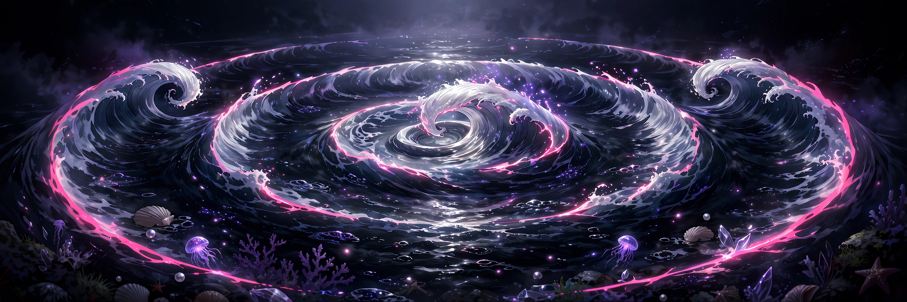

# Second Wave

## 18+ — Adults Only

This game contains adult content. It is intended only for players 18 and older.

### Content notes

- Adult continuation play: driving to a peak, then choosing whether to continue past it or stop.
- Continuing past the peak is presented as a skill, and stopping is a choice with a recorded cost.
- Overstimulation staging: one continuation only, on a reduced curve, while a sensitivity meter climbs.
- Each level is two scenes, and the second scene remembers the first.

All characters depicted are adults.

## A continuation mini-game where you drive channels to a peak and choose whether to push past it once or stop and pay the cost.

<a href="https://github.com/NTRanch/second-wave">GitHub</a> · <a href="https://github.com/NTRanch/second-wave/blob/main/LICENSE.md">License</a> · <a href="https://ntranch.itch.io">itch.io studio page</a>

## Built with

  

## What you do

Hold the space bar or the pointer to drive the active channel, and use the up and down arrows to switch between channels — Pulse, Sustain, and Surge — each with its own rise and decay curve. Drive the depth up to the peak, then choose inside the window: press Enter to continue past the peak on a reduced curve and ride the target band while the sensitivity meter climbs, or press B to stop, end the scene, and pay the recorded cost. You only get one continuation.

Every level is two scenes. The second scene opens with the first one remembered: residue is left in every channel, and the floor is raised if you continued. Later levels add channels, narrow the peak window, and raise the target.

## Features

- Three levels: one channel with a wide 5-second peak window and a target of 650, two channels with a 4-second window and a target of 720, and all three channels with a 3-second window and a target of 780.
- Two scenes per level, with the second scene carrying residue and a raised floor from the first.
- Generated WebAudio that answers input only.

## Media

- [Level 1 preview](../docs/previews/level-1-second-wave.mp4)
- [Level 2 preview](../docs/previews/level-2-second-wave.mp4)
- [Level 3 preview](../docs/previews/level-3-second-wave.mp4)

## Controls

| Action | Keys |
| --- | --- |
| Drive the active channel | Hold SPACE, or hold the pointer |
| Switch channel | ↑ / ↓ |
| Continue past the peak | Enter |
| Stop and end the scene | B |
| Pause | P |

## Status

**v1.0.0** — complete. Built for the Torogao Jam Program (a 14-week, one-game-per-week programme) for the Gameotron jam on itch.io. This GitHub page is the game's home while itch project slots are unavailable.

To play, open `web/index.html` in a browser — one self-contained file that runs offline. Free to play.

## Credits

A Nice Thoughts Ranch game.

Made with C# and Unity.
